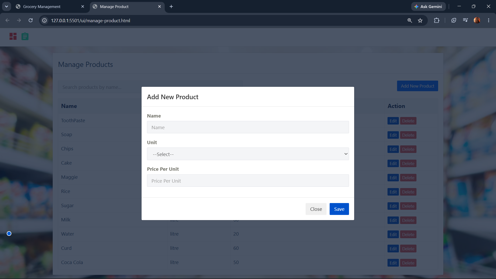
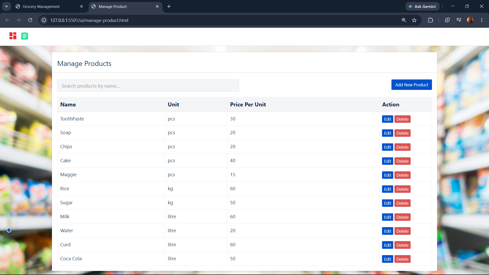
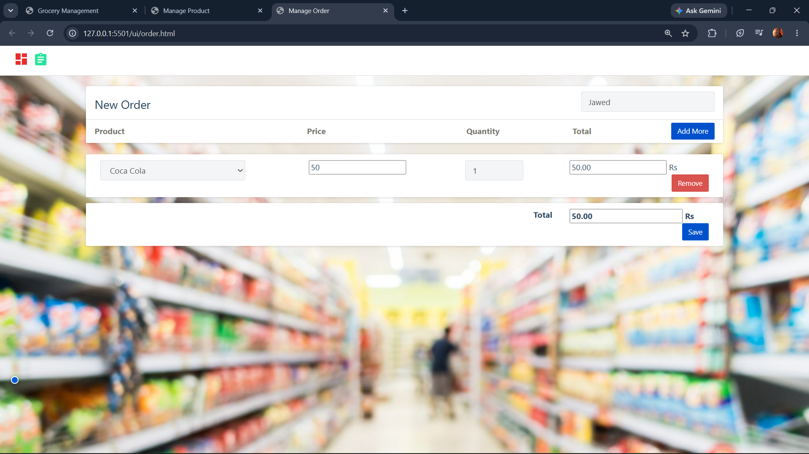
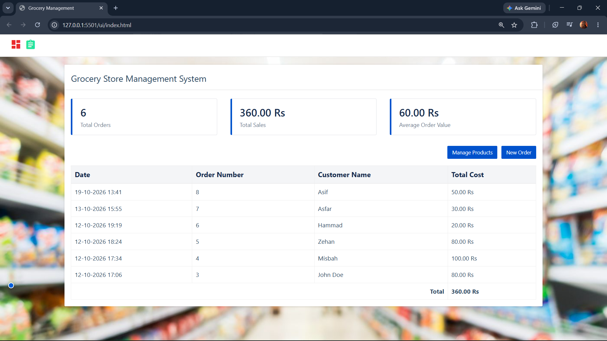

# Grocery Store Application

## Project Overview

The Grocery Store Application is a software project designed to help manage grocery store operations. It connects to a MySQL database to store and manage application data.

This project demonstrates database connectivity, application development, and the use of environment variables to manage configuration securely.

## Features

* MySQL database connectivity
* Database configuration using environment variables
* Organized project structure
* Grocery store management functionality implemented in the application

## Application Screenshots

### 1. Add New Product


### 2. Manage Products


### 3. Create New Order


### 4. Order Management


## Technologies Used

* **Python** — Backened programming
* **Flask** — Backened web framework and API development
* **MySQL** — Database management
* **HTML** — Web page structure
* **CSS** — Styling and layout
* **JavaScript** — Frontend functionality and API integration
* **Bootstrap** — Responsive user interface
* **Git and GitHub** — Version control and project hosting

## Project Structure

The project structure may vary depending on the files in your local repository.

```text
Grocery-Store-Application/
├── README.md
├── .gitignore
├── .env                 
├── backened     
└── ui
```

The `.env` file is intended to remain local and should not be uploaded to GitHub.


## 👨‍💻 Author

**Misbahul Haque**

Computer Science Graduate | Python Developer | Aspiring Software Developer